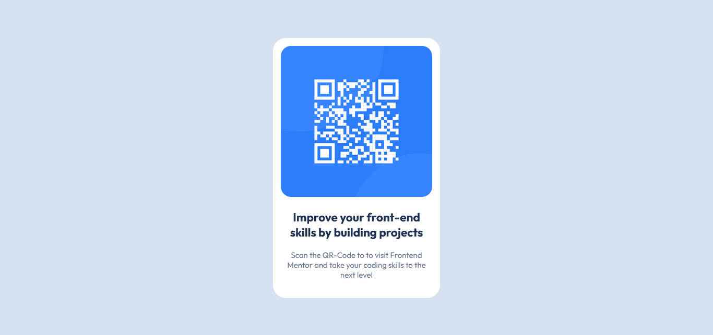

# Frontend Mentor - QR code component solution

This is a solution to the [QR code component challenge on Frontend Mentor](https://www.frontendmentor.io/challenges/qr-code-component-iux_sIO_H). Frontend Mentor challenges help you improve your coding skills by building realistic projects. 

## Table of contents

- [Overview](#overview)
  - [Screenshot](#screenshot)
  - [Links](#links)
- [My process](#my-process)
  - [Built with](#built-with)
  - [What I learned](#what-i-learned)
  - [Continued development](#continued-development)
- [Author](#author)

## Overview

### Screenshot



### Links

- Solution URL: [GitHub Pages](https://vinicius-duarte837.github.io/Desafios-FrontEnd/01-qr-code/)

## My process

### Built with

- Semantic HTML5 markup
- CSS custom properties
- Mobile-first workflow

### What I learned

Although Brazilian Portuguese is my native language, I'll be using English on this document and the projects since is the main language from Frontend Mentor.

This project was useful for me to learn how realistic projects are asked and created. Although the project itself was pretty simple, I must admit I had some difficulties about centralizing the main div element. I tried using Flex but my knowledge on Flexbox is still shallow and I couldn't get it to work, so I went with the position absolute, top and left properties, as seen below:

```css
.main {
			background-color: #fff;
			width: 320px;
			padding: 15px;
			position: absolute;
			top: 50%;
			left: 50%;
			transform: translate(-50%, -50%);
			border-radius: 25px;
			box-shadow: 3px 3px 10px hsla(217, 45%, 22%, 0.432);
		}
```

### Continued development

I realize that Flexbox and Grid Layout are better options to centralize the content, but I want to become more familiarized with both models before trying to use it. Also, in a side note, I didn't use the two resolutions provided by the [style-guide](style-guide.md), the project seems responsive to smaller screens, and it is similar to the mobile design model provided by the website. I do know the concept of Mobile First and Media Queries though. I also need to learn git, I know nothing about it, my repositories are all created manually on GitHub.

## Author

- Frontend Mentor - [@Vinicius-Duarte837](https://www.frontendmentor.io/profile/Vinicius-Duarte837)

