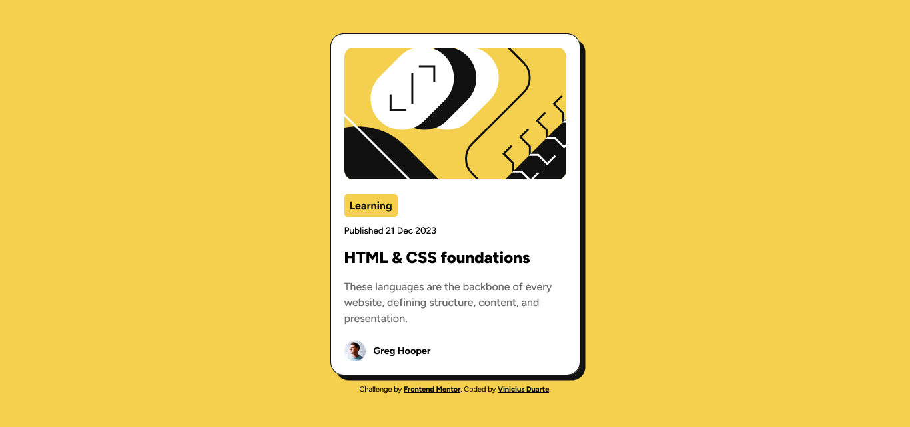

# Frontend Mentor - Blog preview card solution

This is a solution to the [Blog preview card challenge on Frontend Mentor](https://www.frontendmentor.io/challenges/blog-preview-card-ckPaj01IcS). Frontend Mentor challenges help you improve your coding skills by building realistic projects. 

## Table of contents

- [Overview](#overview)
  - [The challenge](#the-challenge)
  - [Screenshot](#screenshot)
  - [Links](#links)
- [My process](#my-process)
  - [Built with](#built-with)
  - [What I learned](#what-i-learned)
  - [Continued development](#continued-development)
- [Author](#author)
- [Acknowledgments](#acknowledgments)

## Overview

### The challenge

Users should be able to:

- See hover and focus states for all interactive elements on the page

### Screenshot



### Links

- Solution URL: [GitHub Pages](https://vinicius-duarte837.github.io/Blog-Preview-Card/)

## My process

### Built with

- Semantic HTML5 markup
- CSS custom properties
- Flexbox
- Mobile-first workflow

### What I learned

I learned more about Flexbox and how to apply it. Project itself was very simple, similar to the previous QR-Code challenge. One thing I forgot it existed and only remembered when searching was the flex-direction property, I was having trouble aligning the main card with the small attribution div, so I looked up for ways to position it and one of the results was the flex direction. It helped a lot.

```css
body{
    display: flex;
    flex-direction: column;
    justify-content: center;
    align-items: center;
    background-color: var(--main-color);
    font-family: "Figtree";
    font-size: 16px;
    height: 100vh;
    width: 100vw;
}
```

### Continued development

I'll keep studying flexbox to learn how to use it more naturally, so far I don't know much about Grid, I'll focus on Flex first

## Author

- Frontend Mentor - [@Vinicius-Duarte837](https://www.frontendmentor.io/profile/Vinicius-Duarte837)

## Acknowledgments

I'll would like to thank the user [@prudence2024](https://www.frontendmentor.io/profile/prudence2024) for providing helpful feedback on my last challenge and showing me how to center the div using flexbox, I tried this time and worked like a charm.
